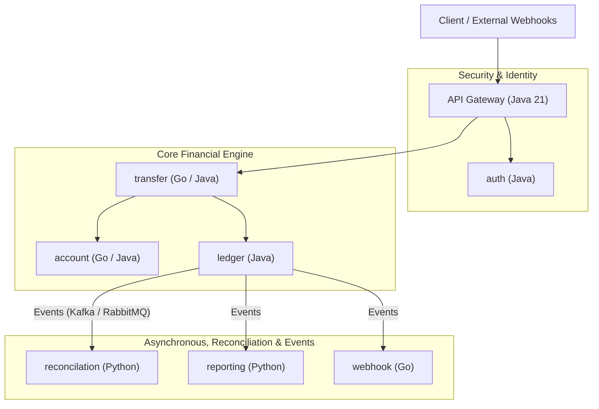

# Kakuzu

> High-performance, distributed, polyglot double-entry financial ledger engine built on a microservices architecture.

---

##  Overview

**Kakuzu** is a financial bookkeeping and ledger platform designed to handle multi-currency accounting, wallet management, money movement, and financial reporting with strict consistency guarantees. 

Named after the Akatsuki treasurer obsessed with financial precision, Kakuzu enforces the foundational rules of financial accounting at the architectural level:
* **Double-Entry Bookkeeping:** Every transaction consists of balanced debit and credit entries ($\sum \text{Debits} = \sum \text{Credits}$).
* **Append-Only Immutability:** Historical postings are never updated or deleted. Corrections are made strictly through reversing or adjustment entries.
* **Exact Decimal Precision:** Zero floating-point arithmetic. All monetary values are handled in minor units (e.g., cents stored as `BIGINT`) or fixed-precision decimals (`BigDecimal` / `NUMERIC`).
* **Strict Idempotency:** Every financial operation requires unique idempotency keys to guarantee safe network retries without duplicate charges.

---

##  Architecture & Services

The system uses a **polyglot microservices monorepo**, pairing each domain with the language and runtime best suited to its requirements:



### Services Directory (`/services`)

| Service | Runtime / Language | Description & Responsibilities |
| :--- | :--- | :--- |
| **`apigateway`** | Java 21 (Spring Cloud Gateway WebMvc) | Edge routing, rate limiting, SSL termination, and stateless JWT token verification. |
| **`auth`** | Java (Spring Security / OAuth2) | User identities, API credentials, and token issuance. |
| **`ledger`** | Java (Spring Boot / jOOQ) | **The Source of Truth.** Immutable journal entries, postings, balance calculations, and database concurrency controls. |
| **`account`** | Go / Java | Chart of Accounts (Assets, Liabilities, Equity, Revenue, Expense) and wallet status lifecycle. |
| **`transfer`** | Go / Java | Money movement orchestrator, idempotency enforcement, and distributed transaction (Saga) coordination. |
| **`reconcilation`** | Python (Polars / Pandas) | Bank feed ingestion (CSV, MT940, CAMT), fuzzy matching, and discrepancy detection. |
| **`reporting`** | Python | Trial balances, balance sheets, profit & loss (P&L) statements, and financial exports (CSV/Excel/PDF). |
| **`webhook`** | Go | High-concurrency event dispatching, retries with exponential backoff, and delivery status tracking. |

---

## Repository Structure

```text
kakuzu/
├── services/               # Microservices
│   ├── account/            # Chart of Accounts and wallet service
│   ├── apigateway/         # Spring Cloud Gateway edge service
│   ├── auth/               # Identity and authentication service
│   ├── ledger/             # Core immutable ledger service
│   ├── reconcilation/      # Bank feed parsing and reconciliation engine
│   ├── reporting/          # Financial statements and reporting service
│   ├── transfer/           # Money transfer orchestrator
│   └── webhook/            # High-throughput webhook notification dispatcher
├── common/                 # Shared contracts (Protobuf schemas, OpenAPI specs)
├── infra/                  # Infrastructure configurations (Kubernetes, Helm, Terraform)
├── docker-compose.yml      # Local development environment (Postgres, Redis, Kafka)
└── README.md
```

---

## Tech Stack & Design Principles

* **Languages:** 
  * **Java 21 (Temurin):** High-integrity financial math (`BigDecimal`), ACID transaction controls, and Virtual Threads (Project Loom).
  * **Go:** High-concurrency I/O, lightweight memory footprint for transfer orchestration and webhook dispatching.
  * **Python:** Data parsing, vector diffing, and financial statement generation.
* **Communication & Contracts:** Contract-first APIs using **Protobuf / gRPC** or **OpenAPI** to bridge polyglot services cleanly.
* **Storage:** PostgreSQL (relational database with pessimistic row-locking for ledger balances) and Redis (idempotency key cache and distributed locks).

---

##  Getting Started

### Prerequisites
* **Java 21** (e.g., Eclipse Temurin 21)
* **Go 1.22+**
* **Python 3.11+**
* **Docker & Docker Compose**

### Running the API Gateway
```bash
cd services/apigateway
./mvnw spring-boot:run
```

---

## License
Internal / Proprietary.
